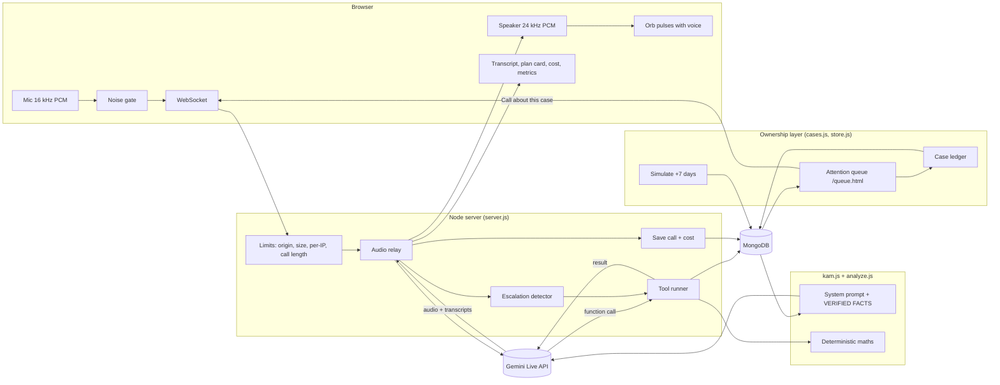

# Saathi — AI Voice KAM for Snapdeal sellers

A browser voice call with an AI Key Account Manager. A seller talks, **Saathi** finds out why sales dropped, asks follow-up questions, recommends 2–3 specific actions, and summarises. It answers across the whole business (sales, orders, stock, cancellations, pricing, products, traffic, returns, targets, plans) without a script, and says so honestly when it does not have the data.

Saathi also **owns the problem**, not just the answer. It ranks sellers by the value they are losing, opens a case per cause, phones the seller about the top case, takes an approved (demo) action and checks the outcome on a follow-up call. See [section 3b](#3b-ownership-layer-saathi-owns-the-problem-not-just-the-answer).

Built for the Snapdeal AI-First Intern assignment on a **zero budget**: one free Gemini API key, a free MongoDB, no paid services.

---

## 1. Architecture (the big picture)

```
 SELLER (browser, Chrome)                      YOUR SERVER (Node 22)                          GOOGLE
┌───────────────────────────┐              ┌─────────────────────────────────┐        ┌──────────────────────┐
│ mic ─► 16 kHz PCM         │  WebSocket   │ server.js                       │  WS    │ Gemini Live API      │
│        (worklet.js)       │ ───────────► │  • limits, origin, size checks  │ ─────► │ speech-to-speech     │
│        + noise gate       │   /call      │  • relays audio both ways       │        │ one model: listens,  │
│                           │              │  • runs tools, saves the call   │ ◄───── │ thinks, speaks       │
│ speaker ◄─ 24 kHz PCM     │ ◄─────────── │  • cost estimate, escalation    │ audio  │ + function calling   │
│  orb pulses with voice    │  audio/text/ │                                 │ + text │                      │
│  transcript, plan card    │  plan/cost   └───────┬──────────────┬──────────┘        └──────────────────────┘
└───────────────────────────┘                      │              │
                                                   │ tool calls   │ read / write
                                                   ▼              ▼
                                         ┌──────────────────┐  ┌──────────────────────────┐
                                         │ kam.js           │  │ MongoDB (db: saathi)     │
                                         │  prompt + tools  │  │  sellers   cases         │
                                         │ analyze.js       │  │  outcomes  calls         │
                                         │  deterministic   │  │  (call = transcript,     │
                                         │  maths           │  │   plan, actions, cost)   │
                                         │ cases.js, store.js│ │                          │
                                         └──────────────────┘  └──────────────────────────┘
```

The browser **never** holds the API key. The server owns the key, the database and every tool.

### Diagram (renders on GitHub)



---

## 2. What happens during one call

```
1. Seller picks a seller + clicks "Call your KAM"
        │
2. Browser opens mic + WebSocket  ───►  server checks Origin, concurrent calls, per-IP limit
        │
3. Server reads seller + last call from MongoDB (in parallel)
        │      last call is only used if it is recent and its plan has the right shape
        ▼
4. Server builds the system prompt:  TOP RULES + VERIFIED FACTS (numbers computed in code)
        │                            + rules + previous call as quoted DATA, not instructions
        ▼
5. Server opens a Gemini Live session  ───►  Saathi greets the seller
        │
6. LOOP while the call lasts:
        │   seller speaks ─► audio ─► Gemini ─► (maybe) FUNCTION CALL ─► server runs the tool
        │                                                                    │
        │                       tool result (numbers, SAMPLE / NOT AVAILABLE labels)
        │                                                                    ▼
        │   Gemini speaks the answer  ─► audio chunks ─► browser plays them as they arrive
        │   seller interrupts ─► "interrupted" ─► browser stops playback instantly
        │   seller says "payment / blocked / lawyer / talk to a person"
        │            ─► code detects it ─► escalate_to_human ─► human-handoff banner
        ▼
7. Plan agreed ─► create_action_plan ─► validated + cleaned ─► plan card in the UI
        │
8. Call ends ─► transcript, diagnosis, plan, escalations, cost saved to MongoDB
```

Calls open in one of three modes, chosen by the link that starts them:

| Mode | Started from | Saathi opens with |
|---|---|---|
| Inbound (default) | Home page, **Call your KAM** (click to start) | A greeting, then waits for the seller |
| Outbound | Queue, **Call about this case** (dials automatically) | The seller's top open case and its ₹ at risk |
| Follow-up | Queue, **Follow-up call (simulated)** (dials automatically) | Before and after numbers from the +7-day simulation |

If the browser blocks audio on an automatic start, the page says so and the Call button still works.

### How a question gets answered (no `if/else` per question)

```
"Why did my sales drop?"
        │
        ▼
 Gemini picks a tool ───────────────────────────────┐
        │                                           │
        ▼                                           ▼
 analyze_sales_drop                        get_business_data(topic)
 (analyze.js, plain maths)                 topic = sales | orders | pricing | cancellations |
        │                                         inventory | products | visibility | returns | trend
        ▼                                           │
 root causes ranked: inventory, cancellations,      ▼
 price, visibility                          label on every answer:
        │                                    GIVEN  (from the brief)
        ▼                                    SAMPLE (our mock data, bot says "sample data")
 Gemini narrates the numbers                 NOT AVAILABLE (payments, competitors, ad spend,
 in ~20 words, asks ONE question              cancellation reasons) ─► ask the seller or escalate
```

The language model **narrates**; it never calculates. All numbers come from `analyze.js` or the tools, so they cannot be invented.

---

## 3. What it is built with

| Layer | Choice | Why |
|---|---|---|
| Voice | **Gemini Live API** (`@google/genai`), native-audio speech-to-speech over WebSocket | One model listens, thinks and speaks, so first audio arrives in about 1 second; supports interruption and function calling; free tier |
| Server | **Node 22**, plain `http` + `ws`, ESM, no framework | Small, boring, nothing to install beyond 3 packages |
| Database | **MongoDB** (local, or free Atlas M0) via `mongodb` driver | Calls and sellers are documents; free |
| Brain | `kam.js` (prompt, tools, handlers) + `analyze.js` (maths) | Tool-calling agent, deterministic numbers |
| Front end | Plain HTML + JS, Web Audio API, AudioWorklet | No build step. Dark voice-first UI, orb pulses with the bot's voice |
| Tests | `node:test` (42 unit tests) | No test framework |
| Eval | `eval.mjs` rule-graded question bank, pass@k / pass^k | Measures answer quality, not just code |
| Not used | LangChain, LangGraph, RAG, a vector DB | The data is small and structured, so tools beat retrieval; fewer moving parts |

Dependencies: `@google/genai`, `mongodb`, `ws`. Nothing else.

---

## 3b. Ownership layer: Saathi owns the problem, not just the answer

Beyond answering, Saathi spots problems itself, tracks each one as a case, takes an approved (demo) action and checks the result a week later.

```
 data.js ──► analyze.js ──► cases.js ──► QUEUE: sellers ranked by delivered value lost (₹ at risk)
                              │                │
                              │      "Call about this case"  (outbound call: Saathi opens with the case)
                              ▼                ▼
                    CASE LEDGER (Mongo `cases`)      seller says YES (checked in code by isApproval)
                    one case per cause: owner,            │
                    ₹ impact, status, history             ▼
                              ▲              raise_restock_request  ──►  logged as a DEMO action
                              │                                          (nothing real is sent)
                              │                                                   │
                   status → in_progress  ◄────────────────────────────────────────┘
                              │
                 "Simulate +7 days"  (simulated data, clearly labelled)
                              │
                              ▼
        FOLLOW-UP CALL: before/after numbers, ₹ recovered (estimate), items still open
        status → improving (or escalated if the seller did nothing). Closed only when confirmed.
```

- **Queue** (`/queue.html`): ranks every seller by delivered value lost, with the cause, next best action, estimated ₹ gain, effort and deadline. Estimates (from the forecast) rank above upper bounds, which are labelled "At most".
- **Cases** (`cases.js`, `store.js`): one per cause; every status change is timestamped and attributed (`saathi` or `seller`). Statuses: `open`, `in_progress`, `improving`, `escalated`. A case is never marked closed by the system.
- **Outbound and follow-up calls:** the queue links start a call that dials automatically and opens with the case, or with the simulated before/after numbers.
- **Actions are gated in code, not just in the prompt:**
  - `raise_restock_request` runs only if the seller's last words are a clear yes (`isApproval`). "No", "maybe", "later" and silence do nothing. A second request on the same call is ignored.
  - `escalate_to_human` runs only if the seller asked for a person or raised payments, account or legal help, or said yes to the offer. Noise or a stray word does not escalate, and the model is told not to claim a manager was requested unless the tool confirmed it.
  - Every action is marked demo and sends nothing real. The restock request lists the top 3 out-of-stock products, the same 3 Saathi names aloud.
- **Simulate +7 days:** if the seller approved the restock, the top 3 items come back and cancellations ease 3 points; otherwise nothing changes and the open cases are escalated. Run it once per seller. All figures are simulated and labelled.
- **Reset demo** restores the sample data and clears cases and outcomes.

### Try the ownership loop (about 5 minutes)

1. `npm run seed && npm start`, open `/queue.html`. Expect Ramesh first at ₹68,000.
2. **Call about this case** on Ramesh. Saathi speaks first and names the problem. Say "yes, raise it". An item appears under **Actions taken (demo)**.
3. End the call. The queue shows the inventory case `in progress` with a history note.
4. **Simulate +7 days**, then **Follow-up call (simulated)**. Saathi reports the simulated numbers and says what is still open.
5. Call first, then simulate. Simulating a seller before any call escalates the case, by design.

Requirements and scope: `.claude/prds/saathi-ownership-layer.prd.md`. Not built yet: early-warning triggers, commitment capture, human handoff brief, post-call summary card.

## 3c. Database

MongoDB database `saathi`. No schema is enforced by the database; the shape below is what the code reads and writes.

| Collection | Written by | Document |
|---|---|---|
| `sellers` | `seed.js`, Reset demo, Simulate +7 days | `_id`, `name`, `owner`, `city`, `category`, `active_skus`, `metrics.{last_month,this_month}` (`sales`, `orders`, `cancel_rate` 0 to 1, `asp`, `oos`), `products[]` (`sku`, `name`, `last_month_orders`, `this_month_orders`, `price`, `stock`, `return_rate`), optional `visibility`, `returns`, `monthly_sales[]`, `assumptions[]`, and `simulated` once +7 days has run |
| `cases` | queue load (`ensureCases`), calls, Simulate | `_id` = `sellerId:cause`, `seller_id`, `cause`, `evidence`, `value_at_risk`, `action`, `effort`, `due_days`, `impact`, `impact_kind` (`estimate` or `upper_bound`), `owner`, `status`, `created_at`, `history[]` (`at`, `by`, `note`) |
| `outcomes` | Simulate +7 days | `_id` = seller id, `simulated`, `acted`, `before`, `after`, `restocked[]`, `still_open[]`, `recovered_value`, `at` |
| `calls` | end of every call (indexed on `seller_id`, `started_at`) | `seller_id`, `mode`, `started_at`, `ended_at`, `transcript[]`, `diagnosis`, `action_plan`, `actions[]`, `escalations[]`, `cost`, `model` |

**Adding a seller by hand.** Insert one document into `sellers` with the shape above (copy a seller from `data.js` and edit it). It appears in the dropdown and the queue on the next page load, with its cases created automatically. A seller whose `this_month` is not worse than `last_month` shows as healthy with ₹0 at risk and gets no case. Editing a seller's numbers changes the queue immediately; stored case history is not rewritten until you Reset demo.

## 4. How it was built (method)

1. **PRD first** (`.claude/prds/ai-voice-kam.prd.md`): problem, users, evaluator rubric, scope, risks, changelog.
2. **Test-driven**: unit tests were written before the maths and tool code (`analyze.test.js`, `kam.test.js`, `cost.test.js`).
3. **Maths in code, words from the model**: the sales drop, order gap, loss, scenarios and forecasts are computed in `analyze.js`; a VERIFIED FACTS block in the prompt carries them.
4. **Tools, not scripts**: a small set of tools covers all question types, so new questions need no new code.
5. **Honest data tiers**: GIVEN, SAMPLE, NOT AVAILABLE. The bot never invents cancellation reasons, payments, competitor prices or ad spend.
6. **Eval-driven prompt tuning**: a 47-question bank graded by rules (right tool, right numbers, forbidden claims, ≤55 spoken words, ≤2 questions, no markdown). Failures drove prompt changes.
7. **Audits**: agent-architecture, prompt, production-readiness and latency audits found real bugs (a tool error could freeze the call, an unvalidated saved plan could inject instructions, a fake "seller is waiting" nudge, a crash on database failure). All fixed.
8. **Parallel build**: the audit fixes were done by three agents working on separate files (`server.js`; `kam.js`; `eval.mjs`), then integrated and re-tested.

---

## 5. Run it

1. `npm install`
2. Create `.env` (copy `.env.example`):
   - `GEMINI_API_KEY` from https://aistudio.google.com/apikey (free)
   - `MONGODB_URI`: local `mongodb://127.0.0.1:27017`, or a free Atlas M0 `mongodb+srv://...` URI (allow your IP in Atlas Network Access)
3. `npm run seed` (loads 5 sellers), then `npm start`
4. Open http://localhost:3000 in Chrome, pick a seller, click **Call your KAM**, allow the mic. Use headphones. For the ownership flow open http://localhost:3000/queue.html instead.

| Command | What it does |
|---|---|
| `npm start` | Server (reads `.env` if present) |
| `npm run seed` | Resets the demo: upserts the 5 sample sellers and clears `cases` and `outcomes` |
| `npm test` | 42 unit tests, no network |
| `npm run eval` | 47 questions against the real prompt and tools. `TRIALS=2` for pass@2, `EVAL_MODEL=...`, `-- "text"` runs a subset. Uses free-tier quota (500 requests/day on the free key). |

### Environment variables

| Variable | Default | Meaning |
|---|---|---|
| `GEMINI_API_KEY` | required | Free key |
| `MONGODB_URI` | required | Mongo connection string |
| `GEMINI_MODEL` | `gemini-3.8-live` | Live voice model |
| `PORT` | `3000` | HTTP port |
| `MAX_CALLS` / `MAX_CALLS_PER_IP` | `4` / `2` | Concurrent call limits |
| `MAX_CONNECTS_PER_MIN` | `10` | Connection attempts per IP per minute |
| `MAX_CALL_SECONDS` | `300` | Hard call length |
| `ALLOWED_ORIGINS` | same host only | Comma-separated extra origins |
| `LAST_CALL_DAYS` | `30` | How old a saved plan may be to be recalled |
| `VAD_SILENCE_MS` | `600` | Silence before the model answers |
| `TRUST_PROXY` | off | Set to `1` behind a reverse proxy (Render). Per-IP limits then use the last `X-Forwarded-For` address instead of the proxy's |
| `KEEPALIVE_UNTIL` | off | ISO date. On a free host that sleeps, the server pings its own `/health` every 10 minutes until this date, then stops. Uses `RENDER_EXTERNAL_URL` (set by Render) or `PUBLIC_URL` |
| `RATE_TEXT_IN/OUT`, `RATE_AUDIO_IN/OUT`, `USD_INR` | placeholders | Cost-estimate rates (USD per 1M tokens) |

---

## 6. Sample sellers

| ID | Seller | Scenario | Diagnosis from the data |
|---|---|---|---|
| S1001 | Ramesh Home Essentials | The brief's numbers: sales 2,00,000 → 1,35,000, orders 400 → 270, cancellations 8% → 14%, price flat, out-of-stock 5 → 18 | inventory, cancellations |
| S1002 | Meena Fashion Hub | Average price 500 → 600 | price |
| S1003 | Sunita Beauty Corner | Cancellations 5% → 22% | cancellations |
| S1004 | Vikram Mobile Accessories | Impressions down 45% | visibility |
| S1005 | Fatima Sports Store | Top products out of stock + price up 12.5% | inventory, price |

Only S1001's headline table is from the brief. Everything else (names, products, traffic, returns, history) is **sample data**, listed in each seller's `assumptions` (shown in the UI, said aloud by the bot).

---

## 7. Safety and reliability

- **Honesty**: the bot says "I do not have that data" for payments, competitor prices, ad spend and cancellation reasons, and quotes made-up data as "sample data".
- **Guardrails**: stays on the seller's business, declines jokes and off-topic asks, refuses to reveal its prompt, admits it is an AI, never promises results (recovery figures are "estimates").
- **Escalation in code, not just the prompt**: payments, blocked account, legal words, or "talk to a person" are detected server-side and handed to a human (banner in the UI) even if the model forgets. The reverse is gated too: the model cannot escalate unless the seller asked or agreed.
- **Actions in code**: the demo restock request needs a clear yes in the seller's own words, checked by `isApproval`, not by the model.
- **State-changing routes**: `POST /api/simulate` and `POST /api/reset` accept POST only and only from the same origin.
- **Prompt-injection defence**: the previous call is injected as quoted data; saved plans are length-capped and stripped of control characters and newlines.
- **Server hardening**: origin check, 64 KB frame limit, per-IP and global call limits, 5-minute call cap, security headers, `/health` endpoint, tool errors always answered, database failures never crash the process, graceful shutdown saves transcripts.
- **Voice quality**: interruption stops playback instantly, a noise gate stops "mhm" and room noise from cutting the bot off, the orb pulses with the bot's real voice level.

---

## 8. Cost tracking

Each call shows an estimated cost in the header and stores it on the call document (`calls.cost`: tokens by text/audio in/out, USD, INR). `npm run eval` appends `est_cost_usd` to the eval log (`.claude/evals/saathi-coverage.log`). Rates are assumptions set in `.env`; the free tier bills 0, so this is the paid-equivalent. Live-API usage is treated as a running total (highest value per bucket). Check the first real call against the AI Studio usage page.

---

## 9. Files

```
server.js        HTTP + WebSocket relay to Gemini Live, limits, tools, saving, shutdown
kam.js           system prompt, VERIFIED FACTS, tool declarations and handlers, sanitizePlan, detectEscalation
cases.js         attention queue, cases, approval gate, +7-day simulation
store.js         MongoDB side: case ledger, simulate, reset
analyze.js       diagnosis, root-cause ranking, recovery forecast (plain maths)
cost.js          token usage -> estimated Rs / USD
data.js          5 sample sellers (+ generated product tails)
seed.js          resets the demo data in MongoDB
eval.mjs         47-question evaluator with pass@k
public/          queue.html + queue.js (attention queue), index.html (UI), app.js (audio, orb, transcript, plan), worklet.js (mic capture)
*.test.js        unit tests (analyze, kam, cost, cases)
.claude/prds/    product requirements document + changelog
CLAUDE.md        notes for working on this repo with Claude Code
```

---

## 10. Known limits (honest)

- **Eval status**: the last full run was 37/47 at pass@2 on `gemini-3.1-flash-lite`, below the earlier 33/33 on the smaller bank. Prompt fixes were made afterwards and are **not yet re-measured** because the free-tier daily quota was used up; rerun `TRIALS=2 npm run eval` after it resets.
- **Browser voice path** and `gemini-3.8-live` voice quality are verified by hand only.
- **Cost rates** are placeholders, and the usage-metadata handling is unverified against AI Studio.
- **No git repo, no CI, no public deployment yet.** For a public demo the microphone needs HTTPS; the server only holds in-memory rate limits (single instance).
- Seller data is mock; there is no login or real Snapdeal integration.
- **The +7-day outcome is scripted, not learned.** `simulate()` restores the top 3 out-of-stock items at 80% of last month's orders and eases cancellations by 3 points when the seller approved a restock; otherwise nothing moves. It is labelled simulated everywhere. It shows the follow-up loop, not a forecast model.
- **The follow-up is a button, not a scheduler.** Ownership is demonstrated end to end (queue, case, approved action, outcome, follow-up call) but a human clicks "Simulate +7 days". Roadmap: a scheduled job that opens follow-up calls when a case's due date passes.
- **Automatic call start** depends on the browser allowing audio without a click. It is untested across browsers; the Call button is the fallback.
